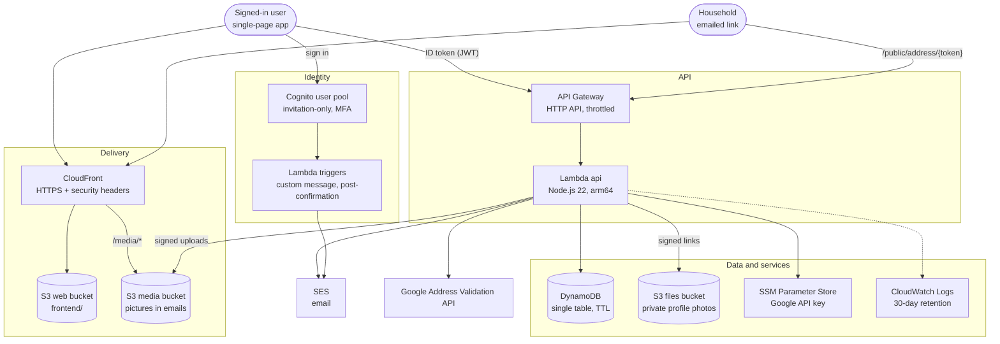

# Occasions Address Book

A small serverless web app that:
- keeps people and mailing addresses;
- tags them for occasions such as Christmas cards, a party or a graduation;
- prints **Avery 5160/8160 labels**, **A2 or A7 envelopes**, and invitations on **Avery 8387 postcards** (with the address on the back) or single cards;
- emails **invitations**;
- emails people a private link to **confirm or update their address**.

Data lives in Amazon DynamoDB, email goes through Amazon SES, and sign-in uses Amazon Cognito (accounts by invitation). The architecture is the same as the Vehicle Maintenance Tracker.

## What it does

- **Address book of households.** Each household is one envelope. Its edit screen has tabs (**Greetings**, **Address**, **People**, **Groups & Notes**); Save keeps the changes on every tab. It holds:
  - a name for the envelope ("The Smith Family");
  - an optional formal name ("Mr. and Mrs. John Smith") and email greeting ("John and Mary");
  - a mailing address;
  - the people in it (name, email, phone), one of them ticked as the **default contact**;
  - a shared email and phone;
  - groups (Family, Neighbors, Work…) and notes.

  Email and phone belong to each person; if people share an email, it goes on each of them (invitations and address checks still send one email per household). Households saved before this keep working: their old shared email and home phone move onto the people the next time you open and save them.

  You can search, and narrow the list with **Filter** (the funnel button): several groups (in *any* or *all* of them), cities, states, ZIP prefix, has/no email, has/missing mailing address, verified addresses (passed the Google check), and address updates to review. Each active filter shows as a chip you can remove; **Clear all** resets. The same Filter is on each occasion's list, so e.g. *everyone in Michigan in the Christmas group* can be added with **Add all shown to the list**.
- **Share a household.** The share icon at the top right of a household's edit screen sends it as a **vCard** (one contact per person, with the household's address; notes and groups stay in the app) or a one-row **CSV**, through the system share sheet (AirDrop, Mail, Messages…) or as a download. What's on screen is shared, including edits not yet saved.
- **Address checks (Google Address Validation).** **Check address** on a household's Address tab asks Google, which uses the Post Office's own address data for US addresses, whether mail is delivered there, and shows the corrected version (street, city, ZIP+4) side by side with yours, to use or keep. It also says when an apartment or unit number is missing. Each check is a ValidateAddress call, billed as Google's "Address Validation Pro" (5,000 free a month); the API counts checks per month (Pacific time, like Google's billing) and stops at 4,000 (`MONTHLY_LIMIT` in `address-check.mjs`), so it stays well inside the free amount. The button turns off when the month's checks are used up and back on when the month turns. A confirmed check is remembered for a week (`VERIFIED#<address hash>` in the table, removed by TTL); saving the household with exactly that address sets `addressVerifiedAt`, shown as a green check in the top-right corner of its card (under the note icon), and changing the address clears it. Set up once: in Google Cloud, turn on the Address Validation API, create an API key restricted to that API, and store the key in SSM:

  ```bash
  aws ssm put-parameter --region us-east-2 --name /occasion-address-book/google-address-validation --type SecureString \
    --value 'YOUR_API_KEY'
  ```

  The button stays hidden until that parameter exists.
- **Import and export** (account menu). Import takes a CSV or a vCard file (.vcf, e.g. from Contacts on a Mac or iPhone, Google Contacts or Outlook; vCard 2.1/3.0/4.0): contacts at the same street address and ZIP become one household, each with a checkbox. A household already in the address book (same Household Greeting, same street and ZIP, or a person with the same name, email or phone; `findExistingHousehold`) isn't added again: the import fills in only what it's missing and what's there always wins (`mergeHousehold` in `csv-core.js`, unit tested). Export saves the address book as CSV or as vCards.
- **CSV details.** Bring in a list from Excel, Numbers or Google Sheets. Columns are guessed from the headers ("First Name", "Spouse", "Zip Code"…) and can be changed before importing. The app's own export imports back unchanged; its People column keeps each person's email and phone, e.g. `John Smith <john@x.com> (248-555-0101); Mary Smith`.
- **Occasions.** Create one ("Christmas cards 2026"), tick who it's for and track who's been mailed or emailed. You can tick households one at a time, or everyone shown after a search or group filter. The duplicate icon on an occasion's card (`POST /occasions/:id/duplicate`) copies it as "Copy of …": settings, design and list (households still in the address book, with each email's recipients), with mailed and sent marks cleared, so next year's cards begin with this year's list. Each occasion has a type:
  - **Cards or Labels:** print labels or envelopes and mark who was mailed.
  - **Invitations:** the same, plus a designed invitation (see below) printed one card per household, filled in with the greeting chosen as the occasion's **Invitation Greeting Style** (Informal, Formal or Household).

  Cards and invitations have an **Address Greeting Style** for the first line of labels, envelopes and postcard backs (Household, Formal or Informal Greeting). The Print window uses these settings rather than asking again.
  - **Emails:** a designed email. The occasion's list shows each household's people who have an email address, each with a checkbox: tick who gets it (ticking a household ticks its default contact). **Edit** has an **Email Greeting Style** setting: Informal (default), Formal, Household, or the first names of the people ticked. The Greeting column shows the result, so a couple's informal "Kim and Jim" can go to Kim alone. The send window lists who each email goes to and can still change a household's greeting (Informal, Formal, Household, the people ticked, or any one person by name).

  Occasions saved as "Other" by earlier versions show as Cards or Labels.
- **Design window** (Invitations and Emails), opened from **Edit** on the occasion (**Design invitation…** / **Design email…**; from a new occasion it creates the occasion first): undo and redo (also ⌘Z / ⇧⌘Z) covering every change, font, size, bold/italic/underline, text color, alignment, bullets, background color, a page border (thin, thick, double, dashed, dotted, rounded or engraved, in any color), pictures (PNG, JPEG, GIF, WebP up to 5 MB; big photos are scaled to 1600 px; drop a file from the Mac onto the page or use **Picture**), and fill-in fields: `{{greeting}}`, `{{occasion}}`, `{{date}}`, `{{time}}`, `{{location}}`, `{{from}}`. The font and text color change the selected words, or the whole design when nothing is selected. Each color swatch (Text, Background, Border color) opens a color window showing the current color and its code, the colors already used in the design (to match one exactly), a palette, a box for a color code, and **More colors…** for the system color picker. **Line** inserts a divider: thin, thick, double, dashed, dotted, rounded or engraved (drawn by the mail app), or a calligraphy flourish (scroll, swash, fleuron or vine, drawn in the browser in the chosen color and saved as a picture, `frontend/ornaments.js`); click a line to change its style, color (through the color window) or length, or remove it. Click a picture to place it (left or right with the text beside it, centered, or in the line), size it, give it a border (the same styles as lines, plus rounded corners, in any color), or remove it; drag it to move it elsewhere in the text. Pictures move within the text rather than anywhere on the page, because mail apps don't keep freely positioned pictures. **Preview** shows the design filled in for each household on the list (‹ › to step through them), with its real greeting and the occasion's date, time and location, including changes not yet saved. The **</>** button shows the HTML to edit or paste in. The API cleans every saved design (sanitize-html allow list: formatting tags and styles only; no scripts, event handlers, frames, forms or `data:`/`javascript:` links). Fonts include standard ones and a few Google Fonts (Great Vibes, Dancing Script, Playfair Display, Cinzel, Lobster, Pacifico, Mountains of Christmas, Amatic SC); these always show in the app and on printed invitations, and in Apple Mail, while Gmail and Outlook use each one's fallback font. Pictures are stored in a separate bucket and served publicly by CloudFront at `/media/<random name>`, because guests' mail apps must load them.
- **Printing invitations:** Print > Invitations opens the filled-in cards in a new tab with the browser's print dialog (Save as PDF there makes a PDF): Avery 8387 postcards (4¼ × 5½ in, four per Letter sheet), 4 × 6 postcards, 5 × 7 cards, half Letter or Letter, portrait or landscape (a single card turns the page; on a sheet of several each design is turned within its place, `inviteLayout`). On postcards, **Print the address on the back** puts each sheet's back right after its front, laid out for two-sided printing flipped on the long edge (each row reversed, `invitePages` in `print-core.js`, unit tested), so every address lands behind its own invitation.
- **Trash.** Deleting a household or occasion moves it to the Trash (account menu) for 30 days. **Restore** brings a household back onto the occasion lists it was on, and an occasion back with its list (including who was mailed and invited); links between two items that are both in the bin come back with whichever is restored second. **Delete forever** and **Empty trash** are there too. After 30 days items are removed automatically (DynamoDB TTL on the item, and the app also hides and purges anything past 30 days since TTL can lag a day or two). Each address book, shared or not, has its own bin; View-only people can look but not restore.
- **Printing.** The Print window asks what to print (Invitations, Addresses or Return addresses), then what to print it on, offering only stock that suits it. Everything prints through the browser: **Print…** opens the pages (a blob: page with a small script) in a new tab, fits any text that's too long (`fitLabel`), and opens the print dialog, where Save as PDF makes a PDF. Layouts are pure functions, unit tested: `print-sheets.js` (label sheets and envelopes as HTML, from the measurements in `print-core.js`) and `label-styles.js` (return-label designs).
- **Design templates.** `frontend/invite-templates.js` (unit tested): starting designs for invitations and emails by theme (`TEMPLATE_THEMES`), each an ordinary design (font, colors, border, HTML with fill-in fields) plus SVG artwork, some shared with the return labels (`ART` in `label-styles.js`). Picking one on the Edit occasion screen saves the occasion, draws the artwork as a PNG, uploads it like any picture, and opens the Designer with the template (saved only with **Save design**).
  - Avery 5160 / 8160 address labels, 30 per sheet, with "start at label N" for a partly used sheet;
  - A2 envelopes (5¾ × 4⅜ in, for 4¼ × 5½ cards) or A7 envelopes (7¼ × 5¼ in, for 5 × 7 cards), one per page, with your return address in the corner;
  - return addresses: a sheet of Avery 5195 / 8195 / 18294 return labels (60 per sheet) or 5160 / 8160 labels, in a design picked by theme from the Styles list (`LABEL_THEMES`: Everyday, Holiday, Patriotic, Spring, Summer, Fall, Fun; nine designs each; drawn in CSS and inline SVG, sized in em of the label's height so one design fits both sheets; the monogram letter is scaled by its measured ink), or A2 / A7 envelopes, which print each recipient with the return address in the corner in the chosen design (the same as Addresses on envelopes with the return address), or with Return address only, just the return address (how many you choose).

  The last stock chosen for each is remembered in the browser.

  Text shrinks (and long names wrap) to fit, so nothing runs off a label. Settings has printer alignment offsets and alignment test pages. After printing, one click marks those households as mailed.
- **Sending emails** (Emails occasions). One email per household, to the person and with the greeting chosen in the send window. Replies go to you. You can send yourself a test first, and each household shows whether its email was sent or failed.
- **Address checks.** Email a household a private link, valid for 30 days, to confirm or correct their address. Their reply comes back for you to review side by side and accept or discard. You also get an email when they answer. Links are stored only as hashes and expire through DynamoDB TTL.

- **Welcome page and help.** Anyone who isn't signed in sees a welcome page (what the app does, and Sign in), on every visit and after signing out. `frontend/help.html` explains every screen, so the screens themselves stay free of instructions; it's linked from the welcome page, the sign-in card and the account menu.

## Architecture

Serverless on AWS, defined as infrastructure as code in one AWS SAM template (`template.yaml`) and deployed by `scripts/deploy.sh`, which runs the tests first.



The API Lambda verifies each Cognito ID token against the user pool's JWKS before it touches data; every item is keyed by the signed-in user's ID (or the shared book they were granted), so one account can never read another's records.

`/public/address/{token}` is the only route that needs no sign-in. It backs `update.html`, the page a household opens from its emailed link. The token travels in the URL fragment (`#t=…`), so it never shows up in server logs.

| Path | Purpose |
|---|---|
| `template.yaml` | AWS SAM template: table, API, Lambda, S3 + CloudFront |
| `backend/src/lib/api.mjs` | REST API routes and validation |
| `backend/src/lib/email.mjs` | Invitation, address-check and reply emails |
| `backend/src/lib/ics.mjs` | Calendar invitations (.ics) for emailed invitations: reads the typed time, 3-hour events in the sender's time zone (unit tested) |
| `frontend/rsvp.html` | Public RSVP page (Yes / Maybe / No, how many, note, Add to calendar) |
| `backend/src/lib/auth.mjs`, `repo.mjs`, `mailer.mjs` | Cognito token check, DynamoDB access, SES (shared with Vehicle Maintenance) |
| `backend/src/handlers/cognito-message.mjs` | Cognito's invitation, password-reset and email-change emails |
| `frontend/auth.js` | Cognito sign-in from the browser (shared with Vehicle Maintenance) |
| `scripts/invite-user.sh` | Invite someone (Cognito emails a temporary password) |
| `scripts/make-admin.sh` | Make someone an admin (`--remove` to undo) |
| `backend/src/lib/directory.mjs` | Cognito accounts: find/invite (sharing), and list, disable/enable, delete (Admin screen) |
| `backend/src/lib/files.mjs` | Profile photos in a private S3 bucket: signed upload/view links (shared with Vehicle Maintenance) |
| `frontend/print-core.js` | Label and envelope layout (unit tested) |
| `frontend/filter-core.js` | Household filters (groups, city, state, ZIP, email, address, review) (unit tested) |
| `backend/src/lib/address-check.mjs` | Address checks (Google Address Validation) and the monthly limit |
| `frontend/design-core.js` | Design fonts, fill-in fields and rendering; `backend/src/lib/design-core.mjs` is an exact copy (a test checks) |
| `backend/src/lib/sanitize.mjs` | Cleans designed HTML on save |
| `frontend/vcard-core.js` | vCard for sharing a household (unit tested) |
| `frontend/csv-core.js` | CSV parsing, column guessing, export (unit tested) |
| `frontend/app.js` | The single-page app (vanilla JS, no build step) |
| `frontend/update.html` | Public "confirm your address" page |
| `scripts/deploy.sh` | Test, build, deploy, publish site |
| `scripts/make-icons.py` | Draws the app icon (`frontend/icon.svg`) and writes the favicon, 192px and Apple touch icons (`pip install cairosvg pillow`) |

### Data model (single table)

```
PK = USER#<Cognito user id (sub)>
  SK = PROFILE                   name, return address, printer offsets
  SK = HH#<id>                   household
  SK = OCC#<id>                  occasion (kind card | invite | email; design: { html, background, color, font, border, borderColor })
  SK = TAG#<occasionId>#<hhId>   household on an occasion's list (mailedAt, invitedAt)
  SK = VERIFIED#<sha256(address)>  an address a check confirmed (marks the household verified when saved with it), removed by TTL after 7 days
  SK = TRASH#<household|occasion>#<id>  a deleted item and its occasion-list rows, removed by TTL after 30 days
PK = RSVP#<sha256(token)>, SK = RSVP     one household's RSVP link for an emailed invitation (answer kept on its TAG row as rsvp), removed by TTL after 400 days
PK = APP#SETTINGS, SK = SETTINGS        app-wide settings from Admin › Settings (idleMinutes)
PK = ACCOUNT#<sub>, SK = OFF            account disabled or deleted by an admin (checked on every request)
PK = TOKEN#<sha256(token)>, SK = TOKEN    address-check link, removed by TTL after 30 days
PK = ADDRCHECK#QUOTA, SK = MONTH#<yyyy-mm>  address checks this month (Pacific time), removed by TTL
```

## Prerequisites

- AWS CLI v2 and AWS SAM CLI, signed in to your account.
- Node.js 22+.
- An SES identity (a verified domain or address) to send from. **While SES is in the sandbox, every recipient must be verified too.** Request production access in the SES console before emailing friends and family.

## Deploy

Deploy in the same region as your SES identity (default `us-east-2`).

```bash
SENDER_EMAIL=noreply@your-domain.com ./scripts/deploy.sh
```

The stack creates its own Cognito user pool, which is protected from deletion and kept if the stack is ever deleted. Cognito's invitation and password-reset emails go out through the same SES identity as the app's email. With `APP_DOMAIN` set, the sender defaults to `noreply@<APP_DOMAIN>`. `ALLOWED_EMAILS` can further limit who may use the API.

### Accounts

Sign-up is by invitation only. Invite yourself (and anyone else) after the first deploy:

```bash
./scripts/invite-user.sh you@example.com
```

Cognito emails a temporary password. Sign in with it and you're asked to choose your own. **Forgot password?** emails a 6-digit code. Whenever a password changes, in **Settings > Security** (the app asks the API to send it) or through **Forgot password?** (a Cognito post-confirmation trigger, `backend/src/handlers/cognito-post-confirmation.mjs`), the account's email gets a *Your password was changed* notice with the time, in the time zone the app last reported, and how to reset it if it wasn't them.

After **30 minutes without activity** (admins can change this under **Admin › Settings**, 5–480 minutes) (mouse, keyboard, scroll or touch) the app signs out, with a **Still there?** warning 2 minutes before; **Stay signed in** keeps any unsaved edits. Activity in one tab keeps every tab signed in, a computer that slept past the limit signs out when it wakes, and reopening the app after longer than the timeout starts at the sign-in screen.

**Settings** (account menu) has five tabs:
- **Profile:** a profile photo (cropped to a square, shown in a circle here and beside your name at the top), your name, the name invitations come from, and your sign-in email (changing it emails a 6-digit code to the new address).
- **Return address:** printed on envelopes and return-address labels.
- **Security:** change password, and two-step verification with an authenticator app.
- **Printer:** the label sheets and envelope sizes offered when printing (`LABEL_SHEETS`: Avery 5160, 5161, 5162, 5197, 5163, 5164, 5168, 5126, 5165, 5195, 5167, with 5160 and 5195 by default, saved as `print.labels`; `ENVELOPES`: A1–A10, square, #6¾–#14, 6 × 9, 9 × 12, with A2 and A7 by default, saved as `print.envelopes`), and label and envelope alignment offsets, with an alignment page for any of them.
- **Sharing:** share your address book and occasions with other people (see below).

### Admins

Admins manage everyone's accounts from **Admin** in the account menu (**Accounts** tab): invite, re-send an invitation, disable or enable an account, and delete it (with all its data and sharing). Admins are the accounts in the user pool's `admin` group:

```bash
./scripts/make-admin.sh you@example.com            # then sign out and back in
./scripts/make-admin.sh someone@example.com --remove
```

The **Settings** tab holds app-wide settings (`APP#SETTINGS / SETTINGS`, returned to everyone in `/me` as `settings`): the inactivity timeout in minutes.

The API checks the group on every `/admin/*` request (from the ID token's `cognito:groups`). Disabling an account also signs it out everywhere, and an `ACCOUNT#<sub>/OFF` row stops its unexpired sign-in tokens right away. Admins can't disable or delete themselves.

### Sharing

Everyone has their own private address book (with its own occasions). You can share yours from **Settings > Sharing** by email, choosing **Can edit** or **View only** for each person (changeable later; **Stop sharing** removes them).

- Someone without an account gets a Cognito invitation with a temporary password; everyone gets an email saying the book was shared with them.
- The people you share with **keep their own address book**. Once a book is shared with them, a switcher appears at the top of the screen listing **My address book** and each book shared with them (e.g. *Mike Szmansky's · Can edit*). The open book drives both **Address book** and **Occasions**, and is remembered on each device. A person can have several books shared with them.
- **Can edit:** everything the owner can do in that book except change its sharing. **View only:** look up, search, export and print; no changes and no emails. The API enforces this, not just the screens.
- Everything in Settings is personal, whichever book is open: name, photo, return address, password, two-step verification and printer alignment. Printing from a shared book uses your own return address.
- Shares are tied to each person's account (their permanent Cognito id), not their email, so either person can change their sign-in email without re-sharing.
- **Settings > Sharing** always manages *your own* book, and also lists the books shared with you.

**Two people at once.** Each household, occasion and design carries the time it was last saved and who saved it. The app sends the version it started from; if the other person saved in between, the save is refused (409) and the app asks *"Jordan changed this household while you were editing it"*: **Load their version** or **Save mine anyway**. Only those buttons answer, so a stray click can't lose either version. Lists also refresh by themselves when the window comes back into view and once a minute, redrawing only when something changed and never while you're typing in a box or have a menu or the Filter panel open.

Stored as `USER#<owner> / SHARE#<member id>` (the owner's list) and `MEMBER#<member id> / BOOK#<owner id>` (the books shared with someone). The app names the open book in an `x-book` request header; the API checks it against these. Shares saved by earlier versions (`SHARED#<email>`, `MEMBER#<id> / BOOK`) move over automatically the next time that person signs in.

## Printing tips

- Print at **Actual size / 100%**, never "Fit to page".
- Labels: use Letter paper. Print one page on plain paper with **Draw outlines** on and hold it against a label sheet to the light. Adjust **Settings > Printer alignment** if needed.
- Envelopes: choose the **A2** or **A7** paper size in the print dialog and feed envelopes the way your printer's tray diagram shows.
- Postcard backs: print two-sided, flipped on the long edge.

## Local development

```bash
cd backend && npm install && npm test
```

The tests cover:
- Cognito token checks (wrong pool, wrong app client, access tokens, expired tokens, unconfirmed email) and per-user isolation;
- Cognito's invitation and reset emails;
- validation and import;
- tagging and copying lists;
- invitations, including SES sandbox rejections;
- the full address-check link flow and its expiry;
- label and envelope geometry (jsPDF builders kept for the geometry tests, and the HTML pages that print);
- CSV round-trips.

To run the site against a deployed API, copy `frontend/config.example.js` to `frontend/config.js` and fill it in. Then serve `frontend/` on port 8080, which CORS already allows.

## Costs

Everything is pay-per-use: DynamoDB on-demand, Lambda, HTTP API, CloudFront, and SES at $0.10 per 1,000 emails. Personal use is typically well under $1 a month. The table is retained if the stack is deleted.

## License

© 2026 Michael Szmansky. All rights reserved. This code is shared for viewing as a portfolio sample; no license is granted to copy, modify, or redistribute it.
